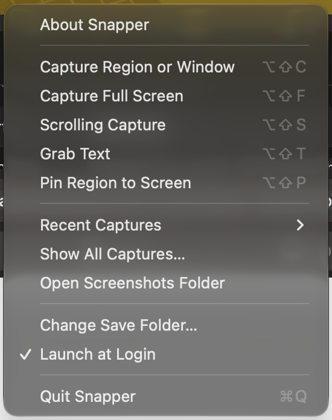
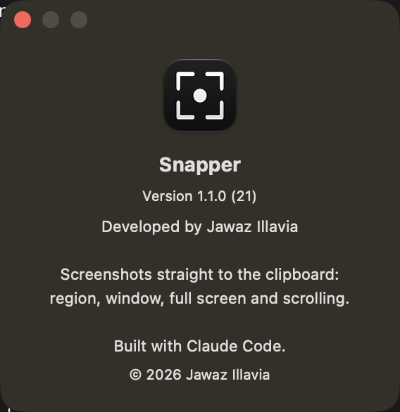

# Snapper

A small menu bar screenshot app for macOS, built as a personal replacement for Snagit.
Every capture goes straight to the clipboard and is saved as a PNG.

 

- Version 1.2.0, developed by Jawaz Illavia, built with Claude Code
- Native Swift, no third-party packages, about 0.9 MB installed
- macOS 14 or later (built and used on macOS 27, Apple silicon)

## What it does

| Default keys | Action |
|---|---|
| Shift-Option-C | Capture a region (drag) or a window (hover and click). Esc cancels. |
| Shift-Option-F | Capture the full screen the mouse is on |
| Shift-Option-S | Scrolling capture: pick the area, scroll down, press Return |
| Shift-Option-T | Grab text: drag over text and it is copied as text, not as an image |
| Shift-Option-P | Pin: drag over an area and it stays floating on top of everything |

All of these are also in the menu bar menu (the viewfinder icon), along with Recent Captures,
Show All Captures (history), Settings and About.

### Settings and shortcuts

**Settings…** in the menu (Command-comma) holds the shortcuts, the save folder and Launch at Login.

Every shortcut can be changed: click its box and press the new keys. Delete clears a shortcut, Esc
cancels, and Restore Defaults puts them all back. Region capture has a second, alternate slot, which
suits a one-key shortcut such as § (top left on British and other ISO keyboards) or a function key.
A key that types something needs Control, Option or Command with it; § and the function keys can be
used on their own. If the keys you choose belong to another Snapper action the two are swapped, and
if macOS refuses the keys the row says so.

### After a capture

1. The image is on the clipboard. Snapper reads it back to confirm, and warns if the copy failed.
2. A PNG is saved to `~/Pictures/Screenshots` as `YYYY-MM-DD HH.mm.ss.png`.
3. A thumbnail appears bottom right for a few seconds. Click it to open the editor, drag it into
   another app to drop the file, or ignore it and it fades. Hovering shows Edit, Pin and Close buttons
   on the right and a Trash button on the left, which moves the saved file to the Trash. The capture
   stays on the clipboard.

### Scrolling capture

Pick the area that scrolls, then scroll down yourself. Snapper grabs frames as you go and stitches
them into one tall image. A bar shows the height so far, with Done (Return) and Cancel (Esc).

- Sticky headers and footers are kept once.
- Scrolling back up is harmless.
- If you scroll so fast that two frames share nothing, the bar says it has lost its place:
  scroll back up a little and carry on.
- It stops by itself at 40,000 pixels tall.

### Editor

Click a thumbnail, or open any capture from Recent Captures or history.

| Tool | Key | Use |
|---|---|---|
| Select | V | Click a mark to select it, drag to move, Delete to remove, double-click text to edit |
| Arrow | A | Drag |
| Box | B | Drag |
| Text | T | Click, type, Return. Drawn as a solid label in the chosen colour so it reads on any background |
| Highlight | H | Drag |
| Numbered step | N | Click; numbers count up |
| Blur / redact | R | Drag over anything to pixelate it |
| Crop | C | Drag the area to keep |

Command-Z undoes, Shift-Command-Z redoes, Command-C copies the marked-up image, Command-S saves and
Command-P prints (also the Print button and File › Print…).
The toolbar shows the zoom percentage: pinch to zoom, or use Command-= and Command--, Command-0 for
actual size and Command-9 to fit the window.
Closing the window saves any changes.

Edits are never final. The PNG in the save folder is a normal flattened image, but Snapper also
keeps the untouched original and the list of marks in `~/Library/Application Support/Snapper/Edits`.
Reopen the capture in the editor and every mark is still selectable, movable and deletable, and
**Revert** takes it back to the original capture. If the PNG is changed by another app, Snapper
treats it as a plain image again. Stored edits are removed when the capture is moved to the Trash
from history, or once the file no longer exists.

### Printing

Print from the editor (the Print button, File › Print… or Command-P) or from history (right-click a
capture and choose Print…, or select it and press Command-P). The editor prints what is on screen,
marks included, saved or not. A capture is shrunk to fit one page and never enlarged; wide ones print
landscape. A long scrolling capture is fitted to the page width and runs over several pages.

### Pins

Drag a pin to move it, scroll over it to resize, and close it with the button that appears on hover,
a double-click or Esc.
Right-click for Copy and Open in Editor. "Close All Pins" appears in the menu when any are up.

### History

"Show All Captures" lists everything in the save folder, newest first and grouped by day. Click to
select, double-click to open in the editor, drag a capture out to use the file, right-click to copy,
print, show in Finder or move to the Trash. Pointing at a capture shows an ✕ in its top left corner,
which moves it to the Trash in one click (it can be put back from the Trash). Captures with stored edits carry an "Edited" badge. History is just the folder, so
there is nothing to maintain.

## Permission

Snapper needs **Screen & System Audio Recording** permission (System Settings › Privacy &
Security). macOS asks on first launch. Nothing else is required: the shortcuts do not need
Accessibility permission.

## Build and install

    ./build.sh

This compiles a release build, assembles `Snapper.app`, signs it with the local Apple Development
identity and installs it to `/Applications`. Signing with the same identity each time is what
keeps the screen recording permission across rebuilds. After a rebuild, reopen the app:

    open /Applications/Snapper.app

Tests (the stitching logic):

    swift test

The app icon is drawn by `Scripts/make-icon.swift`; rerun it and `iconutil` only if the icon changes.

## Changing things

| To change | Edit |
|---|---|
| A default shortcut | `defaultShortcut` in `Sources/Snapper/Settings/Shortcuts.swift` (users change their own in Settings) |
| Version shown in About | `CFBundleShortVersionString` in `Info.plist`, by hand. The build number in brackets is set by `build.sh` to the number of commits, so it rises by itself |
| Name in About, copyright | `Info.plist` and `menuAbout` in `AppDelegate.swift` |
| Default save folder | `FileStore` in `Sources/Snapper/Output/Output.swift` |
| How scrolling frames are matched | `Sources/Stitcher/ScrollStitcher.swift` |

## Code layout

| Folder | Contents |
|---|---|
| `Sources/Snapper/App` | Menu bar, shortcuts, About, log, test hooks |
| `Sources/Snapper/Capture` | Screen capture, the picker overlay, scrolling session |
| `Sources/Snapper/Output` | Clipboard, file saving, thumbnail, text grab, pins, printing |
| `Sources/Snapper/Editor` | Editor window, canvas, annotation drawing |
| `Sources/Snapper/History` | History window |
| `Sources/Snapper/Settings` | Settings window, shortcut storage and recorder |
| `Sources/Stitcher` | Scroll stitching, pure logic with no UI |
| `Tests/StitcherTests` | Pixel-exact stitching tests |

## Troubleshooting

- **Log:** `~/Library/Logs/Snapper.log` records every capture: size, whether the clipboard copy was
  confirmed, where it was saved, and how long it took.
- **A shortcut does nothing or opens another app:** another app has claimed the same keys. Change
  the shortcut here or in that app. Snagit's background helper used to clash; switch it off under
  System Settings › General › Login Items & Extensions.
- **"Needs Screen Recording permission":** switch Snapper on under Privacy & Security, then quit
  and reopen it.

## Test hooks

The app answers `snapper://` URLs, which is how it was tested without a person at the keyboard.
Coordinates are in points from the top-left of the primary display.

| URL | Does |
|---|---|
| `snapper://capture`, `fullscreen`, `scroll`, `text`, `pin` | Same as the shortcuts |
| `snapper://rect?x=&y=&w=&h=` | Capture a rectangle with no picker |
| `snapper://scrollrect?x=&y=&w=&h=` then `snapper://scrolldone` | Scrolling capture of a rectangle |
| `snapper://textrect?…`, `snapper://pinrect?…` | Grab text from, or pin, a rectangle |
| `snapper://history`, `about`, `closepins` | Open history, open About, close all pins |
| `snapper://selftest?kind=region\|window\|editor` | Drive the picker or editor with simulated input |

## Not included

Video recording, auto-scroll, delayed capture, cloud upload and sharing.
